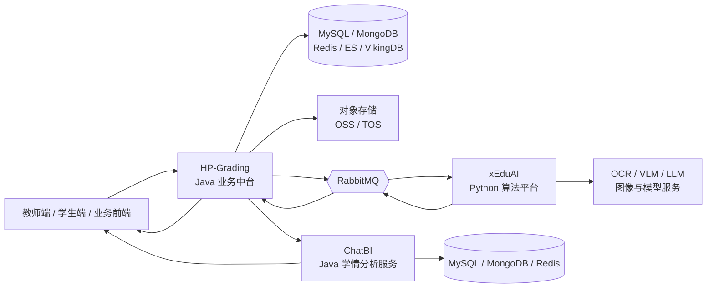
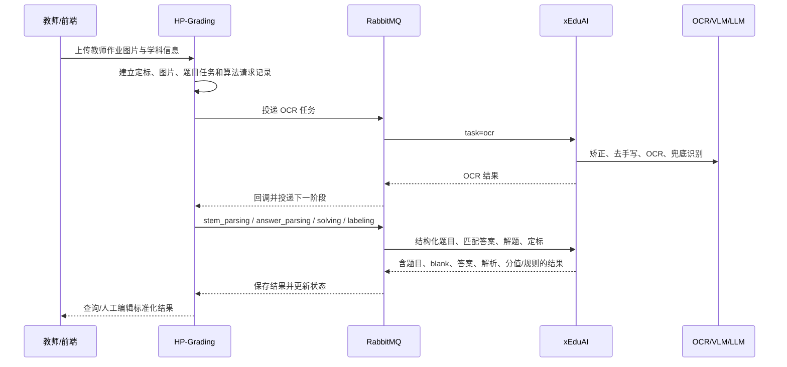
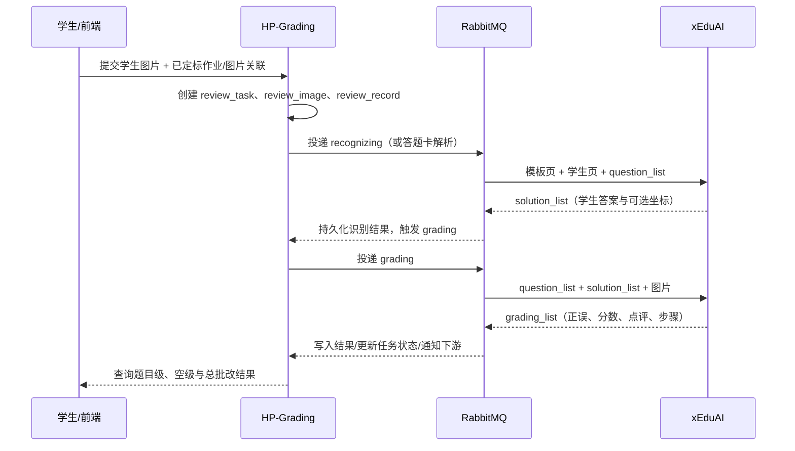

# 01｜整体架构与业务链路

## 1. 产品定位

面向小学、初中、高中作业场景的 AI 批改平台。系统把纸质作业图片转化为可编辑、可批改、可查询的结构化数据，并把教师题目标准与学生作答按题目/小空粒度对齐。

核心业务对象如下：

| 对象 | 含义 | 关键内容 |
| --- | --- | --- |
| 教师定标作业 | 教师上传的原始作业/试卷 | 图片、学段/学科、题目、空、标准答案、解析、分值、评分标准 |
| 定标题目 | 从教师图片结构化出的题目 | 题干、题号、题型、区域坐标、配图、若干 blank |
| blank（小空） | 最小批改单元 | 参考答案、解析、采分点/规则、分数、作答区坐标 |
| 学生批改任务 | 学生提交一次作业的处理单元 | 学生图片、关联的定标作业/图片、批改记录与状态 |
| 批改结果 | 面向前端的最终输出 | 每空学生答案、正误/得分、点评、步骤位置、总结果；作文有专用结果 |

## 2. 三个核心模块分工



| 项目 | 主要责任 | 不应混淆的边界 |
| --- | --- | --- |
| HP-Grading | 身份/业务校验、任务创建、数据持久化、算法请求组装、MQ 回调分发、状态机、结果查询/编辑、重试、监控与通知 | 不直接承担 OCR/VLM 推理主流程 |
| xEduAI | 图片读取与预处理、OCR、结构化解析、模型调用、答案识别、答案/解析生成、逐空/作文评分、调试产物与成本聚合 | 不承担教师/学生业务权限和长期业务主数据管理 |
| ChatBI | 对作业、题目、学生和批改事实进行确定性聚合，形成学生/班级周报、教师/学校/区域统计、排名趋势、建议和报表产物 | 不替代 HP 的交易与权限边界，也不承担 OCR、识别和批改推理 |

## 3. 教师定标（标准答案生成）链路



从回调分发器可验证，普通教师作业定标至少包含以下算法业务类型：`OCR`、`PDF_STEM_PARSING`、`PDF_ANSWER_PARSING`、`PDF_SOLVING`、`PDF_LABELING`。此外还支持单题定标、题目结构化、题目标签、题目导入与推荐等扩展流程。

## 4. 学生作业识别与批改链路



批改并非简单字符串比对：学生识别会把作答与教师模板的题目/blank 对应；批改消费参考答案、解析、评分标准、分值、学生答案以及必要的图像/作答步骤。解答题可回填步骤位置，作文走独立解析、识别、评分链路。

## 5. 学情分析链路

```text
HP-Grading 的作业、学生提交与批改结果
→ ChatBI 按作业/题目/学生形成明细分析
→ 按日/周及组织维度聚合
→ 学生、班级、教师、学校、区域分析
→ 大模型生成教学建议，或生成周报/PDF/Excel
```

代码已验证的主要能力包括单作业题目正确率与错题分布、学生提交与错题分析、学生/班级周报、教师和学校排名、区域看板、日活跃趋势、作文分析及报表生成。后续 Agent 的学习报告、班级讲评等 Tool 应优先复用 ChatBI 的确定性统计口径，而不是从 HP 原始批改记录重新实现一套分析逻辑。

## 6. 跨服务契约与可靠性设计

1. **异步解耦**：业务请求不等待长耗时图像/模型推理；HP 通过队列投递，算法消费者异步处理并回传。
2. **相关性标识**：`request_id` 是算法请求记录和回调的主关联键；`question_id`、`blank_id` 是批改数据闭环的语义键。
3. **版本防倒灌**：HP 的算法回调监听器会比较请求版本与回调版本，丢弃旧版本结果，避免重试/并发时旧结果覆盖新结果。
4. **状态与重试**：后端保存算法请求状态、定标/批改任务与记录状态，并包含重试任务、失败通知、人工编辑后重批能力。
5. **消费保障**：HP 使用手动 ACK；xEduAI 使用 durable queue、持久化消息、QoS、失败 nack/requeue、健壮连接和幂等锁/完成结果缓存。
6. **可观测性**：HP 记录“算法处理延迟”“算法耗时”“后端处理算法结果耗时”等 Prometheus 指标；xEduAI 按阶段输出 timing、调试 JSON 和可视化图片，并聚合模型调用成本。

## 7. 关键技术栈（代码已验证）

| 层面 | 技术 |
| --- | --- |
| Java 后端 | Java 8、Spring Boot 2.3、Spring Cloud Alibaba/Nacos、MyBatis-Plus、Druid、OpenFeign |
| Python 算法 | Python 3、PyTorch/OpenCV（镜像内）、Pillow、NumPy、异步 aio-pika、Redis、请求缓存 |
| 消息与调度 | RabbitMQ、XXL-Job；另有阿里 MQ 相关依赖 |
| 数据 | MySQL、MongoDB、Redis、Elasticsearch、VikingDB 向量库 |
| 模型/AI | TextIn OCR、夸克 OCR/图像服务、VLM/LLM、火山方舟/豆包相关 SDK；模型通过环境变量配置 |
| 存储/部署 | 阿里 OSS、火山 TOS、Docker、GitLab CI/CD、Kubernetes StatefulSet、Prometheus/Actuator |

ChatBI 同样使用 Java 8、Spring Boot 2.3，并使用 MySQL、MongoDB、Redis、RabbitMQ/阿里云 ONS、定时任务和大模型调用承载分层统计、建议与报表。

## 8. 业务覆盖范围

- 基础题目：选择、填空、判断、解答、连线、作图、阅读、英语完形/翻译、语文拼音等。
- 教师能力：作业定标、标准答案/解析/分数编辑、分享、题目查询、答题卡、题目标签、题库/推荐、PDF 相关能力。
- 学生能力：图片提交、识别、普通题逐空批改、结果查询、重批；答题卡与作文有专属流程。
- 运营与质量：错误原因、反馈、知识点、教材版本、题型/题模、题目标签、数据导入迁移、消息通知与埋点。
- 分析与报表：作业/题目/学生分析、学生与班级周报、教师/学校/区域统计、排名趋势、作文分析、PDF/Excel 导出。
