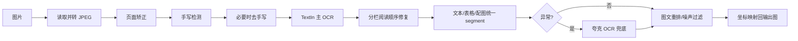
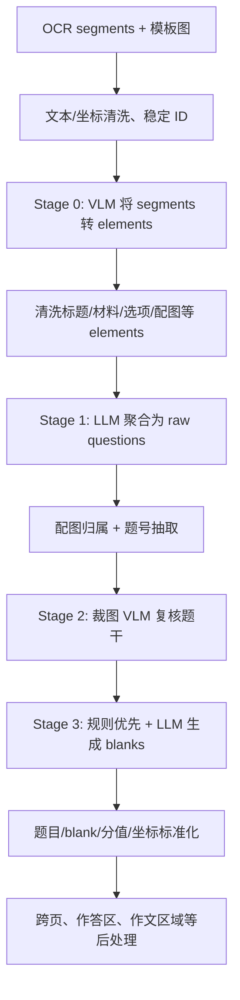
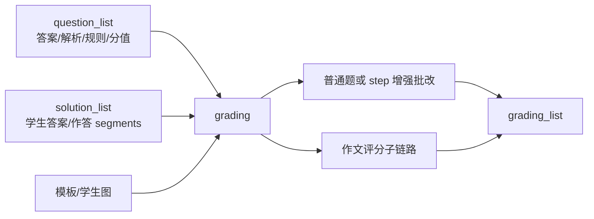

# 03｜xEduAI 算法平台梳理

## 1. 定位与组织方式

`xEduAI` 是 Python mono-repo。它把不同算法能力封装在 `libs/`，由 `services/mq_service.py` 常驻消费 MQ 消息，`services/api_ops.py` 根据消息 `task` 路由到对应能力。

```text
x_edu_ai
├── services/       MQ 服务、生产/消费封装、任务路由
├── libs/           OCR、解析、解题、识别、批改等核心能力
├── assets/         模型、任务样本、基准数据、资源
├── benchmark/      端到端及专项测评
├── debugging/      单模块调试入口
├── tools/          回放、性能分析、链路追踪、URL 签名等工具
├── docs/           OCR、解析、识别、批改等内部说明
└── outputs/        调试与测评产物（不提交）
```

## 2. 服务任务路由

`api_launcher_main` 初始化引擎，`api_routing_main` 按 `inp_msg.task` 调用对应 `api_*_run`：

| task | 能力 | 输入到输出（摘要） |
| --- | --- | --- |
| `ocr` | 试卷 OCR 与页面预处理 | 图片 → 统一 `segment_list` |
| `stem_parsing` | 题目结构化/切题/切空/定位 | OCR segments + 图 → `question_list` |
| `answer_parsing` | 从材料中匹配参考答案与解析 | `question_list + segment_list` → 补全 blank 参考答案/解析 |
| `solving` | 大模型解题 | `question_list` → 参考解/答案及图示信息 |
| `labeling` | 定标结果封装 | 结构化题目及答案 → 定标输出 |
| `recognizing` | 学生作答识别与位置关联 | 模板页 + 学生页 + question_list → `solution_list` |
| `grading` | 普通题/步骤/作文批改 | question_list + solution_list → `grading_list` |
| `essay_parsing` / `essay_recognizing` / `essay_grading` | 作文专用子链路 | 作文题、学生作文 → 作文结构化、识别、评分 |
| `question_card_parsing` | 答题卡解析 | 答题卡场景专用识别 |
| `pos_align` | 位置配准 | 模板/学生页坐标对齐 |

任务路由具有统一异常码映射，并在 `debug_dir` 存在时落下输入输出 JSON，便于从一次请求完整回放。

## 3. OCR：不仅是文字识别

输入单页图片可来自本地文件、URL 或 base64；输出统一的 `segment_list`，每个片段具有 `segment_id`、文本/表格/配图类型和 bbox/polygon/image_id 坐标。



代码/文档已验证的增强点：

- 支持透视/倾斜矫正与旋转输出；
- 通过 VLM 检测手写后按需去手写，且在“去手写后 OCR 为空”时回退原图，保护题干；
- TextIn OCR 为主，整页异常、特定语文/结构异常时夸克 OCR 兜底；
- 统一处理 text/table/figure，表格转 Markdown、图像占位、公式局部 VLM 补识别；
- 修复双栏试卷阅读顺序、选项图文顺序并过滤小噪声图块；
- 输出详细 timing、原始响应、中间图和 segment 可视化，支持定位慢请求和错识别。

## 4. 题干解析（stem_parsing）：从版面到可批改题目

目标不是“抽一段文字”，而是形成后续各环节可直接消费的题目结构：题号、题干、题型、题目坐标、配图、小空、分值、作答区域、跨页关系，以及作文额外信息。



关键输出结构：

```text
question_list[].question_id / question_no / question_type / question_stem
question_list[].question_segment_list / question_pos_list / question_total_score
question_list[].question_blank_list[].blank_id / blank_no / blank_type
question_list[].question_blank_list[].blank_pos_list / blank_total_score
```

算法同时结合规则与模型：连线、完形填空、每空一词、句型转换、翻译、改错、选择、拼音、看图列式、方框填空等高频结构优先走规则，其他题型再走通用 LLM。后处理专门解决题目框扩展、分栏重叠、图文、下划线/括号定位、阅读题和跨页作答区域等难题。

## 5. 参考答案与解题

### 5.1 answer_parsing

该阶段利用题目和 OCR 片段将答案/解析回填到每个 blank，并将答案/解析关联的图片片段保留下来。为控制大输入，超过 5 页或 200 个 blank 时会：

1. 从 OCR 文本抽取题号锚点；
2. 用 LLM 匹配题目与锚点；
3. 以最多 5 题或 50 空为一个 chunk 并发处理；
4. 汇总各 chunk 的题目、成本和结果。

### 5.2 solving

`solving` 按学科/模型配置解题，将生成的答案、解题过程及图示文字写入 `question_list`/`extra_info`。它会汇聚模型调用成本，并支持 debug 输入输出和题目简化快照。

## 6. 学生作答识别：答案文本与坐标双通道

输入是教师模板图、学生图片和已定标的 `question_list`；输出为按 blank 对齐的 `solution_list`。当前可通过 `RECOGNIZE_WITH_OCR_ENABLED` 选择普通或 OCR 增强链路。

OCR 增强链路的关键设计是“**VLM 决定答案文本，OCR 负责作答位置**”：

1. 对学生图做铅笔增强/背面透墨抑制等预处理。
2. 模板题目与学生页面进行几何配准，得到学生图中的题目区域。
3. 同页并发执行 VLM 作答提取和 Quark 手写 OCR。
4. VLM 输出每个 blank 的 `blank_solution`；Quark OCR 输出手写文本/公式及坐标。
5. 先按几何关系把 OCR 候选归入题目；低歧义选择/填空可按顺序短路对齐。
6. 对歧义情况使用 `page_ocr_router_filter` 过滤与分配 OCR 到 blank。
7. 生成 `solution_segment_list`（含学生页坐标），给解答题步骤批改定位使用。

这样避免了用 OCR 直接覆盖 VLM 答案文本，同时把“学生在什么位置写了什么”传给评分模块。

## 7. 批改：逐空评分、步骤定位与作文分流



普通题批改会：

- 为 question、blank、solution 建索引；prompt 内使用连续短 ID，后处理再映射真实 ID；
- 为每个 blank 组合题干、参考答案、参考解析、评分标准、学生答案、分值以及采分点/多解法（评分场景）；
- 选择纯文本 LLM 或携带题目/学生裁图的 VLM；
- 对解答题按需生成预期步骤，使用 `solution_segment_list` 引用步骤，最后把 `segment_id` 反查为真实坐标；
- 处理选择/填空快捷点评、汉译英、作图/连线补批、未作答/漏项补偿与结果排序；
- 输出正误、分数、点评、步骤及 debug 图。`GRADING_WITH_STEP_ENABLED` 控制是否启用步骤增强。

作文题会从普通批改中分流到独立的作文解析/识别/评分实现，并有评分量表、回归/校准、LLM 兜底等代码路径，最终再转换为统一的批改 item。

## 8. 算法服务工程化

- **MQ 可靠性**：持久化消息、durable queue、`prefetch_count`、robust connection/heartbeat、异常 nack/requeue、消费者重连。
- **幂等与优先级**：服务使用任务级幂等存储、处理中锁与已完成结果；同时维护内存队列和 worker 池，具备内存重任务限流概念。
- **异常契约**：图片获取/配准、模型 JSON、上下文超限、远端 API、敏感内容等异常映射为统一状态码，回传上游。
- **缓存与成本**：多模块调用 cache API，按模型调用聚合 `rpc_api_price`，并通过稳定重命名 ID 提升缓存命中。
- **可测试性**：提供模块 debug、服务样例、回放工具、端到端 regression、数学/英语专项 benchmark；产物统一进入 `outputs/`。

## 9. 个人贡献口径与简历可讲主题

已确认：该模块由用户与算法工程师协同开发；用户参与整体方案设计、业务规则和跨模块数据契约定义，并掌握完整处理链路。因此 xEduAI 的流水线和工程化亮点可以作为整个项目的技术亮点写入简历，但个人动作应使用“参与设计/协同开发/定义业务逻辑与协议/联调落地”等准确表述，不能把第三方模型或并非本人独立完成的算法训练写成个人自研。

可讲主题包括：

- 多模态作业处理流水线：图像校正/OCR → 版面语义解析 → 结构化题目 → 解题/批改。
- 规则与大模型协同：高确定性题型规则优先，长尾版式与语义判断交给 VLM/LLM，并配合兜底与后处理。
- 模板-学生页几何配准和 OCR/VLM 双通道答案识别，提升解答题过程定位能力。
- 大模型工程治理：稳定 ID、缓存、成本聚合、chunk 并发、超限切分、JSON 修复、模型替换重试、全链路 debug。
