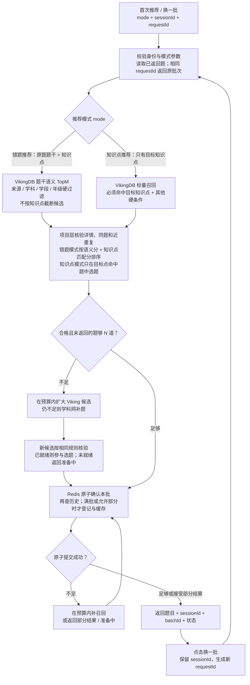
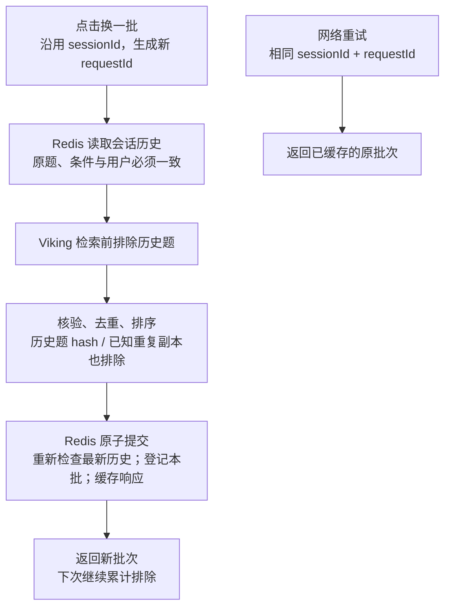
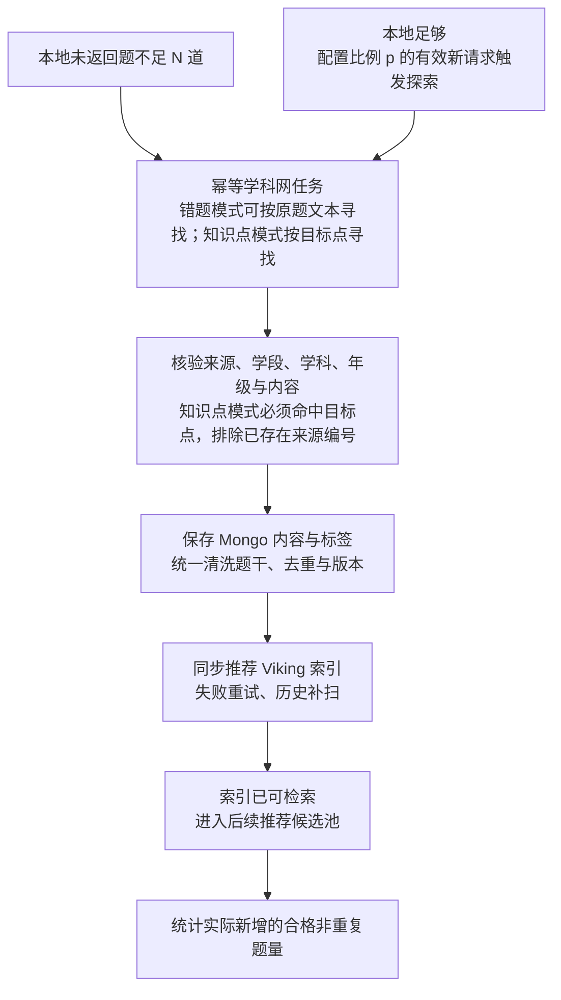

# VikingDB 双入口推荐方案：错题与知识点推题

> 更新：2026-10-12。已确认使用 VikingDB 做推荐；收敛为错题推荐和知识点推荐两个入口。本文是待实施的设计，不代表当前已上线能力。  
> 先看 [流程图解 HTML](16-错题推题流程图解.html)，再查本文的字段与接口细节。两份文档均保存在面试目录。

## 1. 先用一段话说清楚

系统提供两个明确的推荐入口。**错题推荐**输入原题编号，后端取得干净题干及其知识点；VikingDB 在学科网来源、学科、学段、年级等硬条件内做语义召回，不强制候选知识点匹配。项目层排除同题和近重复，按题干相关性加可信知识点匹配分排序，返回 TopN。**知识点推荐**输入学生或班级的薄弱知识点，没有原题题干；VikingDB 必须先过滤目标知识点，再在命中集合中去重、选题。两个入口共用独立的推荐 Collection、题目详情核验、Redis 换批排重和学科网扩库。

两类推荐的调用意图由请求中的 mode 明确表示，不从有没有题干临时猜测。推荐检索统一使用 VikingDB：错题模式做题干向量近邻检索，知识点模式做知识点标量过滤检索。ES 退出这条优化后的推荐链路，不再为推荐新增字段或同步重复索引。学科网既在本地缺题时补题，也按配置的请求比例后台拉取新题。新题完成核验、去重和索引准备后才进入推荐。

## 2. 推荐主流程图

实线表示本次请求；后台扩库另见第 7 节。所有召回渠道遵守来源、学科、学段、年级和可推荐状态等硬条件；知识点只在知识点推荐模式下强制过滤。



图中的补召回有次数、候选规模和耗时上限；没有无休止循环。学科网补题任务按 requestId 幂等触发，轮询同一任务不重复算成新探索请求。

## 3. 按学生的一次操作，逐步解释

### 第一步：确认这次练什么

入口 A：学生打开一道“初中数学、七年级”的错题，后端取到原题干及知识点 A、B、C。学段、学科、年级完全匹配是候选准入条件；缺少知识点标签但题干完整的学科网题可以进入错题推荐的语义召回。不能用“相似度高”补偿年级不匹配。

入口 B：学情服务发现某学生或班级的知识点 B 薄弱，只提供 B，没有原题题干。后端确认用户或班级的学科、学段、年级，映射 B 为统一编号，并在 VikingDB 查询时强制筛选候选的知识点 B。只要选定了 B，就不能通过“内容相似度高”绕过该条件，因为本次请求没有原题向量可比较。

现有标签没有主次。知识点推荐命中 B 标签，说明已标注含 B，不保证 B 是主考点；要严格保证单考点，需要可信的单点题标签或内容核验。标签误差会影响知识点推荐，这一模式需要监控抽检与补标，不能靠没有原题的语义分纠偏。同年级只是符合教学范围的必要条件；有教材、章节或实际进度要求时，还需可靠字段作额外硬过滤。

### 第二步：读取这次会话已经看过哪些题

首次进入时创建 sessionId，并绑定当前用户、推荐模式、学生或班级作用域、原题或目标知识点及硬过滤条件。后续“换一批”复用该 ID。

后端读取该会话的历史集合，将其中的题目编号、稳定来源标识和题干 hash 作为排除条件。这是当前会话的已推荐历史，不等同于学生长期已做题记录。

### 第三步：直接在合格范围内找题

错题模式由 VikingDB 按来源、学科、学段、年级、可推荐状态和会话历史排除，返回题干语义 TopM；M 大于最终 N，为去重和质量核验留余量。知识点只在返回后参与项目层加权排序，即使候选标签缺失或不一致也有机会进入候选池。若评测发现宽召回挤掉了高质量的知识点匹配题，可补一条有知识点过滤的候选查询，合并去重后再排序；它不能替代不按知识点过滤的主召回。

知识点模式必须在 VikingDB 的标量过滤中写入目标知识点集合，返回的每个候选还要由项目层再次核验目标编号，防止索引滞后或标签被更新。若学科网编号与本地编号不同，先映射统一知识点 ID，再检索；无法可靠映射时不放宽为无知识点过滤。无原题就没有语义分。这两种入口共用来源、学科、学段、年级硬过滤、历史排除与最终详情核验，不需要 ES 先筛 ID。

### 第四步：排除同题，再排序

先排除同 questionId、同学科网来源编号、同规范化题干 hash 的题；再判断是否只是原题的近重复版本。近重复检查覆盖原题与候选、同批候选之间，以及可用的会话历史题向量。

语义相似度太低不适合原题相似练习；极高相似度进入拒选或核查区间，因为可能是同一道题；保留区间靠近重复边界时可降权。对一般相似练习，标签缺失 / 不匹配的候选可以设置比标签可信且匹配者更高的语义准入线，并限制本批占比或要求题干复核。阈值用真实同题、排版变化、改数字变式、相关不同题、误标题样本校准；不能把模型分数当成“考查同一知识点的概率”，当前旧去重的 0.95 不直接沿用。

错题模式通过这些规则后，用题干语义相关性和可信知识点集合接近程度评分。知识点标签缺失时按“未知”处理，只是不获得知识点匹配加分，不能据此判定不相关；标签疑似错误时不强行排除。来源、学段、学科和年级匹配都是准入要求，不加分；难度、掌握度和错因不参与本方案。知识点模式在排序前还需核验目标考点，不能由相似度替代。

### 第五步：不够时补题，够时也持续扩库

先在候选规模和耗时预算内扩大 Viking 检索范围，合格题仍不足则调用学科网。新题须通过来源、学科、学段、年级等硬条件和去重，完成入库与索引准备后才能参加相应模式的推荐；错题模式不因知识点标签缺失直接拒绝，知识点模式仍须可靠考点依据。暂未就绪时返回“正在准备”或已有的部分结果。

即使本地足够，探索调度器也会按比例请求学科网，通常在后台完成。本次响应不用等后台扩库，后续请求可使用新题。

### 第六步：登记本批后再返回

选好的候选提交到 Redis，原子地重新检查最新历史、选出尚未分配的题、登记本批并缓存响应。两个并发“换一批”请求即使召回了同一候选，也只能有一个将它分配成功。

默认要求满批：重查后不足时不登记、不缓存已完成响应，先尝试有界补召回；达到上限后可明确允许提交部分批次。已提交的批次不再追加题目，相同 requestId 只取回该批次。零题且外部任务未完成时保留任务状态，轮询后再完成分配。

历史只登记最终分配的题，不登记整个候选池。若网络中断，重试相同 requestId 能取回原批次；再次主动换题才生成新 requestId。

## 4. 新增字段：补哪些，以及为什么补

以下依据仓库写入和模型代码，未直接查询线上 schema。新增推荐字段需要同步修改 Viking 数据集 schema、标量索引和写入链路，并回填历史数据。推荐方案不再要求修改 ES mapping。

### 4.1 VikingDB：让它能独立完成推荐过滤

当前写入只有 question_id、edu_stage、subject、question_body、question_stem；当前查询只按学科分区、取 5 条，filter 被注释。采用新建专门推荐 Collection 及其 Index 的方式，复用 VikingDB 服务，保留现有去重链路；详细资源关系见第 4.7 节。

| 字段 | 当前情况 / 建议 | 实际用途 |
| --- | --- | --- |
| question_id | 已有，保留稳定主键 | 关联 Mongo 详情、排除历史题 |
| edu_stage、subject | 已有，接入过滤 | 学段、学科硬过滤 |
| grade | 新增整数 | 年级硬过滤，避免 ES 先筛年级再查向量 |
| knowledge_point_ids | 新增整型数组，统一知识点编号；允许标签缺失或待复核状态 | 错题推荐用于加权排序；知识点推荐用于必须命中的标量过滤 |
| knowledge_label_state | 新增枚举，例如 VERIFIED / AUTO / MISSING | 区分已核验标签、自动生成待核验标签和缺失标签；可信等级由明确的核验流程赋值，不由向量分数推断 |
| import_type、import_id | 新增来源类型、来源编号 | 限定学科网候选；识别同来源题的不同副本 |
| recommend_key | 新增稳定字符串，如 XKW:12345 | 与 Redis 共用一个历史排重标识 |
| recommend_eligible | 新增布尔值 | 预先汇总发布、删除、已知重复、来源、年级和题干可用性；一般相似练习不因知识点缺失直接设为 false |
| clean_stem、stem_hash | 新增清洗题干及其 hash | 统一向量表示，快速排除完全相同的题干 |
| metadata_version、embedding_version | 新增元数据版本、模型/清洗规则版本 | 最终取详情时识别陈旧索引；统一相似度的计算口径 |

recommend_eligible 不代表难度合适或学生掌握程度。它由明确条件计算；下线、删除、标签修正时立即更新，最终取详情时仍核验。来源、学段、学科和年级为两个模式的独立硬过滤条件；知识点字段保存为可查询元数据，错题模式不必按它过滤，知识点模式必须过滤。

推荐向量由 clean_stem 生成，包含选项和必要小问，保留数字、公式、否定词；不拼入答案和解析。当前学科网导入使用“题干 + 答案 + 解析”，需要重建历史推荐向量。关键图形不能从文本获得时，应标记语义依据不足或采用独立的图形表示方案。

轻量检索只返回 ID、必要过滤元数据、hash 和分数，不传整份 question_body。字段补齐的收益是减少串行跨库查询、减少非法候选挤占 TopK、降低返回体积；具体延迟收益须测量，不能预先宣称提升比例。

VikingDB 官方提供数组字段、标量过滤和主键排除能力，但相应字段须开启标量索引，当前 SDK 的参数与限制需核验。[字段类型](https://docs.volcengine.com/docs/vector_database_vikingdb/createvikingdbcollection?lang=zh)、[标量过滤](https://docs.volcengine.com/docs/vector_database_vikingdb/Scalarfiltering-3?lang=zh)、[主键排除](https://docs.volcengine.com/docs/vector_database_vikingdb/Primarykeyfiltering-3?lang=zh)。

### 4.2 知识点模式：VikingDB 强制过滤目标点

VikingDB 提供标量检索，可在同一次查询中对 `knowledge_point_ids` 做目标点 `must` 过滤，并叠加来源、学科、学段、年级等硬条件；按已建立标量索引的数值字段排序、分页取候选，不要求提供原题文本或查询向量。[Java 标量检索文档](https://docs.volcengine.com/docs/vector_database_vikingdb/searchbyscalar-1?lang=zh)、[标量过滤](https://docs.volcengine.com/docs/vector_database_vikingdb/Scalarfiltering-2?lang=zh)。

`question_id` 这样的数值字段只能用于稳定遍历，不是推荐质量分。对目标 B，可优先通过可靠标签核验、较少的总知识点数表示题目较聚焦，再用 sessionId 派生的稳定种子在同档候选内轮换，并限制同题干簇或同来源变体占满一批。较少标签只是一种弱信号，不能断言 B 是主考点。需要对检索候选有界分页，扩宽候选范围后再选 TopN；不能长期只从 ID 最小的前一页挑题。标签缺失或无法映射到 B 的题不能在本模式中通过检索条件，先走补标流程。

单个目标知识点模式下，可选增加 `knowledge_point_count`：候选均包含目标点时，`1 / knowledge_point_count` 可以作为较聚焦的弱排序信号。它不能替代完整标签集合，也不能识别主知识点。若一次请求包含多个目标点，先明确是“全部包含”还是“任一包含”，不能任由 OR / AND 默认值决定教学语义。

落地需核对当前 SDK、数据集及标量索引能力，必要时升级 SDK 或调用对应数据面接口；现有 searchByText 方法没有直接实现上述标量检索。切换前验证硬过滤、历史排除和分页，不能只新增字段就宣称已完成替代。

### 4.3 推荐链路统一由 VikingDB 检索

| 情况 | 查询路径 |
| --- | --- |
| 错题推荐，Viking 合格候选足够 | Redis → Viking 题干语义 TopM → 项目层加权排序 → 批量 Mongo 核验 → Redis 提交 |
| 知识点推荐，只有目标知识点 | Redis → Viking 目标点标量硬过滤 → 知识点候选选题 → 批量 Mongo 核验 → Redis 提交 |
| 本地候选不足 | 有界扩大 Viking 候选；仍不足再走学科网 |
| Viking 不可用 | 返回准备中或稍后重试；明确选择故障策略，不再默认维护 ES 备用推荐索引 |

最终 Mongo 核验负责发现下线、标签变化、详情缺失与索引版本落后；淘汰后有界补足，同时安排索引修复。不把 sessionId 写进题库文档；题目属性放在 Viking，用户会话历史放在 Redis。

这次撤回为推荐新增 ES 派生字段的建议。ES 若另有全文搜索、复杂聚合或题库管理等实际业务，可由那些业务继续使用；是否停用整个 ES 服务要另外核查调用者。当前源码推荐还在使用 ES，迁移切换前保持原链路，本文描述的是切换后的设计，不是已经删除现有 ES 代码。

### 4.4 ES 也能做题干相似度，为什么当前方案选择 Viking

ES 有两种相关能力：

| 方式 | 实现 | 含义与限制 |
| --- | --- | --- |
| 词项相似 | 将清洗题干存为 text 字段，使用全文查询或 more_like_this | 按分词后的词项找相似文本；不能等同于语义或数学解法一致 |
| 向量相似 | 同一 embedding 模型生成题干向量，存 dense_vector，再计算相似度 | 可做语义召回，现代版本支持 ANN；仍需硬过滤与近重复控制 |

参考 [More Like This](https://www.elastic.co/guide/en/elasticsearch/reference/current/search-more-like-this.html)和[向量检索](https://www.elastic.co/docs/solutions/search/vector/knn)。

仓库 hp-grading-service/pom.xml 中 ES 客户端与依赖版本为 7.10.2，未直接核验线上服务端版本；当前 ES 模型与查询没有接入题干向量或 MLT 相似检索。若服务端也是 7.10，可使用 dense_vector + script_score / cosineSimilarity，对过滤后匹配的文档逐条计算，匹配集合增大时成本随之增加。size 只控制返回数量，不将计算限制为这几条。原生 ANN 在 ES 8.0 引入，不能将当前新版本能力直接套到 7.10 环境。[7.10 向量字段](https://www.elastic.co/guide/en/elasticsearch/reference/7.10/dense-vector.html)、[7.10 脚本评分](https://www.elastic.co/guide/en/elasticsearch/reference/7.10/query-dsl-script-score-query.html)、[8.0 ANN](https://www.elastic.co/blog/introducing-approximate-nearest-neighbor-search-in-elasticsearch-8-0/)。

已于 2026-10-12 确认采用 VikingDB 统一推荐，复用现有服务与集成。ES 的能力对比保留作为选择依据，不再将推荐引擎列为待决策项；这不意味着 ES 做不到相似度或 Viking 一定更快。接下来验证的是选定 Viking 方案的模型效果、过滤能力、延迟与成本，不维护另一套重复的 ES 推荐索引。

### 4.5 现有 embedding：模型、检索算法与距离要分开

| 层次 | 仓库事实 | 负责什么 |
| --- | --- | --- |
| Embedding 模型 | local、test、CI 配置记录 doubao-embedding-vision，版本 250328 | 将题干文本转换成稠密向量 |
| 近邻检索算法 | VikingDBUtil 建索引工具配置 HNSW | 建立近似最近邻索引，加速寻找相近向量 |
| 距离 / 相似度 | 同一工具配置 COSINE | 衡量两个向量的方向接近程度 |

HNSW 和 COSINE 都不是 embedding 模型。Java 仓库没有包含模型结构或训练实现，不能凭上述配置声称其具体网络结构、训练算法或线上实际模型。

配置证据见 [bootstrap-local.yml](/D:/project/hp/hp-grading/hp-grading-service/src/main/resources/bootstrap-local.yml:99)。当前检索方法没有传模型名；VectorUtil 的 embeddingV2ByText 则使用调用方传入的 modelName。检索的实际模型、版本和维度由线上 Collection 向量化配置决定，不能仅根据配置文件确认；在 Java 中未查到对 embedding_model_name / embedding_model_version 这两个配置键的直接读取。

显式路径是 VectorUtil → vikingDBService.embeddingV2 → 返回 sentence_dense_embedding；当前题目去重路径是 Collection.upsertData 写文本 → Index.searchByText 查文本，依赖数据集配置自动向量化。两条路径都调用云端能力，Java 本身不执行模型推理。[VectorUtil](/D:/project/hp/hp-grading/hp-grading-service/src/main/java/com/hp/grading/utils/VectorUtil.java:50)、[现有去重 Repository](/D:/project/hp/hp-grading/hp-grading-service/src/main/java/com/hp/grading/viking/impl/QuestionDeduplicationVikingRepositoryImpl.java:38)、[官方文本检索前提](https://docs.volcengine.com/docs/vector_database_vikingdb/searchbytext?lang=zh)。

建库工具的 setVectorize 被注释，question_stem 被定义成 Vector 类型，而写入方法传的是文本。此工具不能直接当作线上 schema 的证据，也不能照抄到新推荐建库流程。模型版本、维度、自动向量化字段和索引参数都需读取线上配置后确认。[建库工具](/D:/project/hp/hp-grading/hp-grading-service/src/main/java/com/hp/grading/utils/VikingDBUtil.java:32)。

**新推荐 Collection 明确选 2048 维。**仓库 local/test/CI 配置记录 `doubao-embedding-vision / 250328`；火山引擎官方材料列出该模型系列默认 2048 维，但旧 Collection 的实际维度不能从仓库确认：建库工具把 `dim` 留作接口入参，另有一处写死的 4096 维字段定义，自动向量化配置却被注释。实施时先读线上 Collection schema，并用一次真实返回向量核对长度；新旧 Collection 即使模型名称相同，也不能在未核对清洗规则、模型版本和维度时混用分数。[模型维度资料](https://docs.volcengine.com/docs/vector_database_vikingdb/create-2?lang=zh)、[当前工具](/D:/project/hp/hp-grading/hp-grading-service/src/main/java/com/hp/grading/utils/VikingDBUtil.java:38)。

### 4.6 VikingDB、Milvus、Chroma 的名称如何对应

以下用普通稠密向量检索比较。Collection 类似关系库的表，仅用于理解数据组织，不意味着支持关系库的事务或关联查询。

| 概念 | VikingDB：按当前 SDK | Milvus | Chroma：常规 dense API |
| --- | --- | --- | --- |
| 服务 / 逻辑库 | 连接指定地域的服务，再选择 Collection；当前 SDK 链路没有先建 database 的步骤 | 服务实例下有 Database，再有 Collection | Tenant → Database → Collection |
| 表 / 数据集 | Collection，保存记录、字段和向量化配置 | Collection，定义 schema 和字段 | Collection，组织文档、向量和元数据 |
| 一行记录 | DataObject | Entity | Record / Item |
| 主键 | 自定义主键字段，如 question_id | Primary field，如 question_id，可配置 AutoID | ids 参数中的唯一字符串，如 XKW:12345 |
| 原始文本 | clean_stem 等 text 字段；按接口配置自动向量化 | clean_stem 等 VARCHAR 字段 | documents 参数 |
| 向量字段 | 自带向量模式可自定义，如 stem_vector；自动向量化模式由服务管理向量，不预先假定固定字段名 | 自定义字段，如 stem_vector，指定 FLOAT_VECTOR 和 dim；可有多个向量字段 | embeddings 参数；不是在 schema 中任意命名的 stem_vector 列 |
| 过滤字段 | grade、subject 等普通字段，并配置相应标量索引 | Scalar fields，配合 filter 表达式 | metadatas 字典，配合 where 条件 |
| Index | 在 Collection 上建立的检索索引资源；写 Collection、查 Index | 建在指定字段上的索引；查询通常指定 Collection 和 anns_field | 常规使用创建 / 配置 Collection 后直接 query，不单独 getIndex 查询 |

Viking 的自动向量化和手动传向量是两种建库方式，不能把“文本字段”和“向量字段”混成一个类型；当前官方创建接口要求这两种配置二选一。它还规定单个 Collection 只支持一个 vector 类型字段，因此不应套用 Milvus 的多向量字段方案。[Viking 创建数据集](https://docs.volcengine.com/docs/vector_database_vikingdb/createvikingdbcollection?lang=zh)。

Milvus 的 Database 是 Collection 之上的逻辑分组；一个 Collection 可以有多个命名向量字段，搜索时通过 anns_field 指明使用哪个。[Database](https://milvus.io/docs/manage_databases.md)、[Collection](https://milvus.io/docs/manage-collections.md)、[多向量 schema](https://milvus.io/docs/v2.4.x/schema.md)。

Chroma 的主要数据槽位是 ids、documents、embeddings、metadatas；Tenant 和 Database 负责组织 Collection。metadata 并非任意关系表列，支持的类型与过滤算子须按部署版本核对。[数据模型](https://docs.trychroma.com/docs/overview/architecture)、[query 与 get](https://docs.trychroma.com/docs/querying-collections/query-and-get)。

### 4.7 新推荐：新建 Collection，再建立它的 Index

仅在旧 Collection 上增加 Index，不会把旧向量的输入内容从“题干 + 答案 + 解析”变成“干净题干”；索引算法、距离参数与向量化输入是不同层次。当前学科网导入确实拼接了这三部分，教师题目的部分写入路径只传题干，因此旧集合里的文本口径并不统一。

推荐新建如下资源。名称是实施建议，不是已创建的线上资源：

```text
VikingDB 服务
├─ 现有去重 Collection
│  ├─ 保留现有数据和向量化配置
│  └─ 现有去重 Index → 定标 / 导入查重
└─ question_recommend_v1：新推荐 Collection
   ├─ question_id：稳定主键
   ├─ clean_stem：干净题干、选项、必要小问
   ├─ grade / subject / edu_stage / knowledge_point_ids / 来源等
   ├─ 自动向量化配置：只读取 clean_stem
   └─ question_recommend_hnsw_v1：新 Index → 相似练习推荐
```

推荐 Collection 仅写入核验合格的学科网题目。教师原题可作为查询文本，不写成推荐候选。用 question_id / import_id 关联现有 Mongo 题目详情；答案和解析仍保存在原详情存储，新推荐向量不使用它们。

实施步骤：创建字段与 clean_stem 自动向量化配置 → 建 HNSW / COSINE 向量索引和必要标量索引 → 回填合格学科网题 → 验证可检索和版本 → 切换推荐 Repository。后续导入和更新幂等同步推荐 Collection；标签或内容变化时更新，删除 / 下线时及时撤销准入，最终详情核验继续执行。

原题查询也使用同一套题干清洗规则、模型版本和维度。干净题干保留数字、单位、公式、条件、否定词与必要选项；图形信息不足的题要明确处理。相同模型仅更换输入内容也要重新生成向量；旧混合文本向量不能通过改 Index 名称直接复用。不要把现有工具里的 4096 硬编码当作新模型维度。

两个 Collection 是两套用途明确的检索表示，新增的是向量存储、计算资源及同步成本，并不要求部署第二套 Viking 服务或复制完整题目详情。模型或清洗规则后续发生不兼容变化时，新建版本化 Collection，回填核验后切换配置，不在同一向量空间混用不同模型。[Index 与 Collection 关系](https://docs.volcengine.com/docs/vector_database_vikingdb/create?lang=zh)。

### 4.8 使用方式和部署上的区别

| 产品 | 常见接入步骤 | Embedding 在哪里做 | 本项目中的判断 |
| --- | --- | --- | --- |
| VikingDB | 创建 Collection / 向量化配置 → 创建 Index → upsert 文本 → 带过滤查文本 | 采用自动向量化时由云服务完成；也可自行生成后写向量 | 已有 Java SDK 与去重链路，复用服务并新增推荐 Collection |
| Milvus | 定义 schema / 向量字段 → 建字段索引 → load → insert / upsert → search | 可由应用或 SDK 工具生成；支持的 2.6.x 版本还可配置 Function 调外部 embedding 服务 | 能做推荐；若迁移需要部署、模型接入与数据搬迁，不是本轮必要工作 |
| Chroma | 创建 Collection 并配置 embedding_function → add / upsert 文档和 metadata → query | Python 等 SDK 的 embedding function 可本地运行或调用模型 API；也可直接传 embeddings | 接入 Python 检索较简洁；有本地、服务端和 Cloud 形态，不把本地形态的容量结论推广到所有部署 |

Milvus 不自带唯一的默认“语义算法”，也不能笼统说它必须由应用自己调用 embedding；[Embedding Function](https://milvus.io/docs/embedding-function-overview.md) 能在相应版本中接入外部模型。Chroma 的 [Embedding Functions](https://docs.trychroma.com/docs/embeddings/embedding-functions) 可配置模型，支持的客户端默认可用 all-MiniLM-L6-v2，但不能默认套用于所有客户端，更不能认为这是每个 Chroma 数据库固定使用的算法。

三者若使用同一模型、同一文本处理和参数，得到的 embedding 表示可以一致；换数据库不会自动提升模型语义理解。不同产品和距离类型的返回分数定义不同，应统一解释为本方案的 semanticScore 后再排序。容量比较使用真实题量、维度、过滤比例、TopK 和模型调用配额测量，不仅凭产品名称判断高并发能力。

### 4.9 “数据库自己计算向量”究竟算了什么

输入文本经过模型的文本预处理和推理，得到固定维度的一串浮点数；入库文本和查询文本必须使用可比较的模型、版本及处理规则。随后向量索引按相似度寻找近邻。`doubao-embedding-vision` 是仓库配置记录的模型名称，不能从名称反推出模型内部网络、训练目标或具体参数。HNSW 用于近邻索引，COSINE 用于比较向量方向，均不负责把文字变成向量。

“自动”说的是应用只传文本，由配置的模型调用链产生向量，计算也可能发生在客户端 SDK、本地模型或外部推理服务，不表示向量数据库内核自己训练了一个模型：

| 产品 | 传文本并自动得到向量 | 传已生成的向量 | 两种方式的关系 |
| --- | --- | --- | --- |
| VikingDB | 创建 Collection 时配置 vectorize，服务按指定模型处理文本；写入与检索均可使用文本接口 | 创建已有向量字段的 Collection，由应用传向量 | 当前创建接口把 vectorize 与显式 vector 字段作为互斥建库方式；新推荐选择前者 |
| Milvus | 支持的 2.6.x 版本可配置 TEXTEMBEDDING Function，让服务调用外部模型；也可用客户端模型工具 | 应用生成向量，写入命名向量字段 | 都使用 Collection 中的向量字段，是否接入 Function 由 schema 与版本决定；不是 Viking 式的两个互斥建库类型 |
| Chroma | Collection 绑定 embedding function 后，客户端可用 documents / query_texts 触发模型 | 客户端用 embeddings / query_embeddings 传已有向量 | 通常是同一 Collection API 的两种输入路径，不是两个不同的建库类型；模型可能本地运行或调用外部 API |

依据：[Viking 创建数据集](https://docs.volcengine.com/docs/vector_database_vikingdb/createvikingdbcollection?lang=zh)、[Milvus Embedding Function](https://milvus.io/docs/embedding-function-overview.md)、[Chroma Embedding Functions](https://docs.trychroma.com/docs/embeddings/embedding-functions)。

### 4.10 两种模式下，知识点由谁来过滤与评分

Viking 标量 filter 可以在近邻检索时组合 must / must_not / and / or，但它只能依据题目当前保存的字段值过滤，无法推断标签实际是否正确。它返回候选和向量匹配分；“知识点没匹配但题干足够相关，可不可以推荐”还涉及标签可信度、近重复风险和教学意图，应由推荐服务决定。[Viking 标量过滤](https://docs.volcengine.com/docs/vector_database_vikingdb/Scalarfiltering-2?lang=zh)、[SearchByText](https://docs.volcengine.com/docs/vector_database_vikingdb/searchbytext?lang=zh)。

| 请求模式 | Viking 查询条件 | 项目层决策 |
| --- | --- | --- |
| 错题推荐：题干＋原题知识点 | 学科网来源、学科、学段、年级、可推荐状态；主召回不按知识点截断候选；取有界 TopM | 排同题和过度相似题；题干分主导、可信知识点匹配加权。标签缺失 / 不匹配但语义充分相关者仍可入选。宽召回覆盖不足时，再补有知识点过滤的候选查询并合并 |
| 知识点推荐：只有薄弱点 B | 相同硬条件＋目标 B 的标量 `must` 过滤；不用题干向量查询 | 结果再次核对 B 和题目状态；在命中 B 的候选中优先可靠标签、适度聚焦及批内多样性。缺标签不直接推荐，先补标或返回不足 |

错题模式可设置语义下限 `T_rel` 和近重复上限 `T_dup`：低于下限的候选不够相关；达到上限的候选可能是同题或改数字版本，进入拒选 / 复核区间。知识点匹配只加权，不要求命中；`knowledge_label_state=VERIFIED` 需要可追溯的人工确认或可靠规则核验，自动打标默认不等于已核验。阈值按学科、题型、模型版本与人工标注样本校准，不沿用现有去重的 0.95，也不把分数解释成知识点正确率。

即便数据库提供分数后置处理，也不能把两种模式都写成“标签命中 OR 相似度过阈值”的标量 filter。错题模式的知识点加权、标签可信度与重复判定，以及知识点模式的可靠标签核验，属于项目层业务决策。当前 Java Repository 的 filter 甚至未启用，只有学科 partition、limit=5，故完整准入、分桶、去重、排序和会话逻辑需要在项目中实现。[当前 Repository](/D:/project/hp/hp-grading/hp-grading-service/src/main/java/com/hp/grading/viking/impl/QuestionDeduplicationVikingRepositoryImpl.java:62)。

## 5. “换一批”：sessionId 的完整规则

### 5.1 两个 ID 分别做什么

| 字段 | 含义 | 什么时候变化 |
| --- | --- | --- |
| sessionId | 一次推荐会话，记录此前所有已返回题 | 切换推荐模式、原题、目标知识点、学生/班级或硬过滤条件时变化 |
| requestId | 一次点击操作，用于重试幂等 | 每次主动点击换一批都生成新的值；网络重试沿用原值 |
| batchId | 后端分配的一批结果 | 成功分配新批次时变化 |

同 sessionId + 新 requestId：取下一批，排除历史所有批次。  
同 sessionId + 同 requestId：取回原批次，用于网络重试，不再次扣题或增加学科网探索次数。

### 5.2 会话排重流程图



### 5.3 最小 Redis 数据设计

```text
rec:{userId:sessionId}:meta       用户、原题、过滤条件指纹、失效时间
rec:{userId:sessionId}:seen       已分配的 questionId 与 recommend_key
rec:{userId:sessionId}:hashes     已分配题目的 stem_hash
rec:{userId:sessionId}:requests   requestId → 已完成的批次响应 / 任务状态
```

相同花括号部分让相关 key 在 Redis Cluster 中落到同一 hash slot。最终选题、检查历史、加入集合与保存批次响应由有界 Lua 脚本原子执行；脚本只操作少量候选元数据，不进行数据库、模型或学科网调用。[原子脚本](https://redis.io/docs/latest/develop/programmability/eval-intro/)、[Cluster hash tag](https://redis.io/docs/latest/operate/oss_and_stack/management/scaling/)。

查询前读历史只是提前缩小召回范围；返回前原子重查才保证并发不重复。并发导致候选被其他请求抢先分配时，预算内补召回，仍不足就明确返回部分结果或准备中。

会话绑定当前用户、推荐模式、学生/班级作用域和条件指纹，后台校验访问权限。改变原题、知识点、年级或作用域时开新会话；失效的 sessionId 返回明确失效状态，不悄悄丢弃历史后继续以同一个 ID 推旧题。

TTL 可从闲置 30 分钟作为讨论起点，实际按业务配置，前端获知 expiresAt。设置历史集合与批次数上限，超限提示结束本会话；不静默删除最早的历史题。该保证依赖会话状态可用，Redis 不可用时不能宣称已完成会话排重。

题干 hash 只消除确定的相同题干；近重复还需要相似度核验。跨会话的长期已做题排除，属于另一个需求，不混入本次 sessionId 设计。

### 5.4 一个容易看懂的例子

| 操作 | sessionId | requestId | 返回 | Redis 累计排除 |
| --- | --- | --- | --- | --- |
| 首次推荐 | S1 | R1 | Q1、Q2、Q3 | Q1、Q2、Q3 |
| 换一批 | S1 | R2 | Q4、Q5、Q6 | Q1 至 Q6 |
| 因超时重试 | S1 | R2 | 仍是 Q4、Q5、Q6 | 仍是 Q1 至 Q6 |
| 再换一批 | S1 | R3 | Q7、Q8、Q9 | Q1 至 Q9 |

这是行为示例，不是线上数据或已实现功能。

## 6. 两类入口分别排序，不混用分数

### 6.1 错题推荐：语义主导，知识点加权

候选先通过来源、学科、学段、年级等硬过滤，再排除原题、同题、过度相似题和会话历史。对合格候选统一计算：

```text
s = 同一模型版本下校准后的题干语义相关分
k = |原题可信知识点 ∩ 候选可信知识点| / |原题可信知识点 ∪ 候选可信知识点|
    若任一方标签不可信或缺失，令 k = 0（不加分，不据此拒绝）
rank = s + λ × k
```

`λ=0.1` 可作为离线调参起点，不是上线确定值。题干相关性应主导；只有双方标签可信时，集合重合才给小幅加分。Viking 原始 score 的范围、方向及模型版本要实测确认后再校准为 `s`，不把旧去重的 0.95 或未校准的混合检索分数当成相关性概率。低相关阈值在加权前判断，不能靠知识点加分拯救无关题。

知识点集合越接近，越能减少“只偶然命中一个标签”的候选；仍不代表识别了主知识点。标签不一致的候选仍可进入最终 TopN。若评测显示无标签 / 不匹配候选噪声高，可提高其语义准入线或进入题干内容复核，不能因此把知识点一律变成前置硬过滤。

### 6.2 知识点推荐：必须命中目标点，按可靠性与覆盖选题

知识点模式没有原题语义分，不能套用上面的公式。候选必须命中目标知识点，项目层复核标签状态：VERIFIED 可直接参与，AUTO 需完成内容核验后再准入；只有 MISSING 时先补标。多个标签的题目可用 `1 / knowledge_point_count` 作较聚焦的弱信号，并控制同题干簇、相同来源变体的批内数量。同档题用与 sessionId 绑定的稳定轮换顺序，避免永远只选 ID 最小的题。确定同题和会话历史排除仍执行，不能承诺同等的语义近重复保障。

同分时可用稳定编号作为最后的排序次序；“换一批”的变化由会话历史排除和有界轮换实现，不通过扰乱高相关性结果凑变化。

## 7. 学科网：补题与固定比例扩库

### 7.1 扩库流程图



本地足够时，B 至 H 在后台运行，不阻塞本次返回。本地不足时，可以等待已就绪的新候选至耗时上限；未就绪则返回部分结果或任务状态，不绕过过滤直接展示外部题。

### 7.2 比例如何计算

例如 p=20% 作为讨论起点，可按 mode、学段、学科、年级设置计数桶，分别保证错题文本路线与知识点路线持续扩库。每桶每 5 个有效新请求至少安排一次外部调用；其中已经走缺题补足的请求可计入配额。比例控制实际发起外部调用的请求，不强制每批展示 20% 新题。

requestId 重试、任务轮询不重复计数。首次推荐、主动换一批等有效新请求都纳入调度，不能被缓存响应绕过。外部失败记录为失败或欠额，不能算扩库成功；补偿受调用预算约束。

外部返回题仍必须有可靠匹配的学段、学科、年级标签；接口无法表达年级时，后端核验返回标签。缺少这些准入标签不能作为本次推荐候选；知识点缺失在错题模式中可暂存为待核验，知识点模式则先补标或核验内容。

### 7.3 如何避免调用很多次仍不长库

轮换知识点桶，并使用学科网接口实际支持的分页或排除能力；以 importId / recommend_key 去重，不假设接口已经支持某个未核验参数。跟踪调度数、实际调用数、成功数、新增合格题数。新增持续为零时调整请求策略，不能只看调用次数。

索引更新是异步的：导入、标签、模型版本和推荐 Viking 索引用统一元数据版本；幂等写入、失败重试、补扫历史。Viking 已收到写入不等于立即可检索，新题准备状态应可查询。其他业务如仍使用 ES，其原有同步另行维护，不作为推荐准入的依赖。

## 8. 前后端接口草案

接口命名与字段是设计草案，尚未修改现有 DTO。单一推荐模块提供两个 mode；调用方只选择意图，不指定排序算法或跨库步骤。模块内部由两个召回与排序策略处理各自的输入，共用资格过滤、详情核验、会话排重、学科网调度和索引写入；外部只需一次 `recommend(request)` 调用。

错题推荐：

```json
{
  "mode": "WRONG_QUESTION",
  "sessionId": "首次可为空，后续换一批沿用",
  "requestId": "每次点击新值，网络重试原值",
  "sourceQuestionId": 123,
  "audienceType": "STUDENT",
  "audienceId": 1001,
  "num": 10
}
```

知识点推荐：

```json
{
  "mode": "KNOWLEDGE_POINT",
  "sessionId": "首次可为空，后续换一批沿用",
  "requestId": "每次点击新值，网络重试原值",
  "targetKnowledgePointId": 456,
  "audienceType": "CLASS",
  "audienceId": 2001,
  "num": 10
}
```

枚举值和编号仅作结构示例，实施时使用仓库实际枚举。WRONG_QUESTION 必须能解析到原题题干及其学科、学段、年级；KNOWLEDGE_POINT 必须能解析到统一的目标知识点编号。学生或班级的学科、学段、年级应从可信业务数据读取；客户端提供的 audienceId、标签和维度只能作定位线索，后端须校验权限、班级归属和上下文。客户端切换模式或作用域应重新开会话。

```json
{
  "sessionId": "S1",
  "batchId": "B2",
  "status": "OK / PARTIAL / PREPARING / NO_MORE / SESSION_EXPIRED",
  "items": [],
  "expiresAt": "会话失效时间",
  "pendingTaskId": "有补题任务时返回"
}
```

前端显示“换一批”，正在提交时禁用重复点击，但后端仍做并发控制。新操作创建 requestId；传输失败重试使用原值。会话失效提示重新开始；正在准备时查询已有任务，不无限提交新推荐请求。NO_MORE 仅表达本次合格候选与调用预算已用尽，不声称整个题库永远无题。

普通原题级 TopN 响应缓存不能直接用于换一批；可按原题和模型版本缓存错题模式的查询向量或候选，知识点模式不发生在线题干 embedding，但每次仍须执行会话排除和原子提交。已经完成的 requestId 响应缓存用于重试。

## 9. 落地顺序与验证

1. 固定两种 mode 的参数与上下文解析，落实共同的来源、学科、学段、年级硬过滤及权限校验；知识点 ID 与学科网 ID 建映射。
2. 新建推荐 Collection 和对应 Index，补元数据、清洗题干与版本；回填合格学科网题的推荐向量，验证错题模式宽召回与知识点模式目标点 `must` 过滤，缺字段不得自动放宽。
3. 落实 sessionId、requestId、Redis 历史与原子提交，两类 mode 分别绑定会话条件，验证并发换批无交集。
4. 接入 Viking 题干语义 TopM、项目层语义主导加权与近重复核验；接入目标知识点标量检索、标签可靠性核验、稳定轮换。按两类 mode 分别验证后，再将现有 ES 推荐调用切换到 Viking。
5. 接入学科网缺题补足和比例探索，分别跟踪错题文本路线与知识点路线的新增合格题量、导入状态和索引就绪状态。
6. 用人工标注的“相关不同题、误标题、改数字重题”评估错题召回率、TopN 相关率、近重复率；知识点模式评估目标点准确率、覆盖率和空结果率。核验越界候选为零、同会话连续批次无交集、重试返回原批次、并发不重复、年级与知识点均不隐式放宽。

性能按 mode 分别关注 Viking 检索与题干 embedding 耗时、候选淘汰率、批量详情次数、接口 P95、空结果率与换批成功率。知识点模式无查询题干 embedding，瓶颈更可能来自标量检索、详情核验和分页。字段冗余会增加存储和同步成本，先以减少查询步骤与非法候选证明收益，再给出实测延迟结果。

### 9.1 推荐接口 TPS 预估，供容量规划

**给定数值：混合流量按 30 TPS 稳态容量规划。**假设 70% 错题推荐、30% 知识点推荐，100 万道可推荐题，2048 维 HNSW、Float 存储，TopM 约 50，2 个 Java Pod、每个 2 CPU，推荐索引至少 2 CU，Mongo 批量取详情，Redis 原子登记；学科网扩库异步执行，不计入同步接口。100 万条 2048 维 Float 向量本体约 8.2 GB，尚不含 HNSW 和元数据，故不能用 1 CU 的 8 GB 内存作此规划。仓库生产 StatefulSet 写的是 2 个副本、每个 2 CPU，属于部署清单而非已核实的线上实时资源。[部署清单](/D:/project/hp/hp-grading/hp-grading-statefulset-prod.yaml:7)、[CU 资源说明](https://docs.volcengine.com/docs/vector_database_vikingdb/VectorLibraryComputingResourceAllocationReference?lang=en)。

| 流量口径 | 规划值 | 含义 |
| --- | ---: | --- |
| 全部是错题推荐 | 25 TPS | 每个新原题通常要在线生成一次查询向量，串联语义检索与近重复核验 |
| 全部是知识点推荐 | 60 TPS | 只做标量检索，无查询题干 embedding；仍需有界分页与详情核验 |
| 70% 错题 + 30% 知识点 | **30 TPS** | 本方案的单一稳态容量目标，不是实测吞吐 |

按每次请求平均 1.3 次 Viking 检索（包括补召回），30 TPS 约消耗 39 检索 QPS。官方说明 1 CU 约可支持 100 QPS，2 CU 的粗略检索预算约 200 QPS；实际与维度、TopK、过滤、索引参数和数据量有关，因此 39/200 只是检索层容量校验，不能直接换算成接口 TPS。若每道查询题干平均 150 tokens、错题占 70%，在线 embedding 约需 `30 × 70% × 150 = 3150 tokens/s`；官方列出的向量库 V1 文本 embedding 账号共享默认限额是 33000 tokens/s，但实际账号配额及 SearchByText 内部计量仍须核实。[索引 CU](https://docs.volcengine.com/docs/vector_database_vikingdb/create?lang=zh)、[向量库配额](https://docs.volcengine.com/docs/vector_database_vikingdb/Vectorlibraryquotadescription-1?lang=zh)、[性能影响因素](https://docs.volcengine.com/docs/vector_database_vikingdb/FAQsaboutperformance?lang=zh)。

以接口 P95 ≤ 800 ms 为初始目标；若压测得到平均响应耗时 500 ms，30 TPS 对应约 15 个平均在途请求，这只是并发预算的条件计算，不是测得的延迟。基准压测要在包含 Redis、Viking、批量 Mongo、会话换批及 20% 扩库调度的完整链路上，以 10 → 20 → 30 → 40 TPS 梯度增加，并分别验证错题 / 知识点占比、候选不足、同题去重和高频换批；一旦错误率、限流或 P95 越线，就以实测稳定点替换 30 TPS 规划值。

## 10. 面试时可以这样回答

“我们把推荐分为错题和知识点两个入口，统一使用 VikingDB 中独立的干净题干推荐 Collection。错题推荐有原题干和知识点，先按学科网来源、学科、学段、年级硬过滤，Viking 做题干语义 TopM 召回；知识点标签可能不准，所以它在项目层小幅加权，不作为必选条件。我们排除原题、重题和过度相似题后选 TopN。知识点推荐只有薄弱点，Viking 必须按该点做标量过滤，没有原题语义分，命中题再按标签可靠性、聚焦程度和批内去重选题；缺题时不放宽目标点和年级。两个入口共用 sessionId 换批排重、学科网补题与按比例扩库，重试沿用 requestId。方案仍待实施，需要先验证过滤、评分样本、SDK 与延迟。”

## 11. 当前代码事实与依据

- [Viking 当前写入与查询](/D:/project/hp/hp-grading/hp-grading-service/src/main/java/com/hp/grading/viking/impl/QuestionDeduplicationVikingRepositoryImpl.java:38)：缺知识点、年级等推荐过滤字段，filter 注释，只取 5 条。
- [学科网向量文本](/D:/project/hp/hp-grading/hp-grading-service/src/main/java/com/hp/grading/task/impl/QuestionImportTaskImpl.java:758)：题干混入答案和解析。
- [ES 题目模型](/D:/project/hp/hp-grading/hp-grading-service/src/main/java/com/hp/grading/es/po/QuestionESPO.java:17)：已有结构化维度和状态字段。
- [ES 查询](/D:/project/hp/hp-grading/hp-grading-service/src/main/java/com/hp/grading/es/impl/QuestionIndexRepositoryImpl.java:92)：知识点 OR、来源编号排除、创建时间排序；删除过滤注释。
- [当前推荐流程](/D:/project/hp/hp-grading/hp-grading-service/src/main/java/com/hp/grading/manager/impl/QuestionRecommendManagerImpl.java:119)：当前不等于本文优化方案，按知识点入口放宽年级的逻辑应移除。
- [模拟问答 Q32](/D:/project/resume-interview/hp-grading-项目梳理/12-模拟面试官提问与回答.md:494)：保留真实实现与待实施方案的区分。

