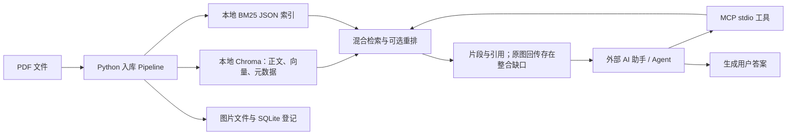

# MODULAR-RAG-MCP-SERVER 项目源码学习指南

> 核查日期：2026-10-14。依据本地仓库 `D:/project/rag-github/MODULAR-RAG-MCP-SERVER`，Git commit：`f658c5a4011c8b826707a65a3b11ce9301b0626f`。本文以实际调用代码为准，区分模板默认、可选实现与未实现的设计。没有调用云端模型或下载权重；验证边界见第 15 节。

## 1. 先看清项目的角色

这是一个 Python 编写的、供外部 AI 助手调用的知识检索 MCP Server。它提供 PDF 入库、混合检索、可选重排、引用和图片响应、管理界面以及评测框架。

**查询服务内部不调用生成模型撰写最终答案。**`query_knowledge_hub` 调 HybridSearch、可选 Reranker 和 ResponseBuilder 后，返回检索片段与引用。用户看到的最终讲解主要由 Copilot、Claude 等外部 MCP 客户端的模型生成。配置中的 `llm.model=gpt-4o` 用于入库 Transform、可选 LLM 重排和部分评测，不能把它称为这条查询链路里的“最后回答模型”。



代码：[查询工具](/D:/project/rag-github/MODULAR-RAG-MCP-SERVER/src/mcp_server/tools/query_knowledge_hub.py:273)、[响应构建](/D:/project/rag-github/MODULAR-RAG-MCP-SERVER/src/core/response/response_builder.py:153)、[MCP 工具注册](/D:/project/rag-github/MODULAR-RAG-MCP-SERVER/src/mcp_server/protocol_handler.py:192)。

## 2. 用了哪些模型、数据库、库和中间件

### 2.1 模型清单

| 环节 | 默认配置或可选模型 | 实际使用方法 | 默认状态 |
| --- | --- | --- | --- |
| ChunkRefiner | `gpt-4o` | 每个 Chunk 切完后调用文本 LLM 清理噪声 | `use_llm=true`，失败退回规则结果 |
| MetadataEnricher | `gpt-4o` | 生成标题、摘要、Tags 写入元数据 | `use_llm=true`，失败退回规则结果 |
| ImageCaptioner | `gpt-4o` Vision | 图片输入生成文字描述，描述写入 Chunk 正文 | `vision_llm.enabled=true` |
| Dense Embedding | `text-embedding-ada-002`，1536 维 | Chunk 文本和查询文本都使用同一个文本模型 | 真实 API 调用实现存在 |
| Cross-Encoder Rerank | YAML 写 `cross-encoder/ms-marco-MiniLM-L-6-v2` | Sentence Transformers 本地加载模型，给 query/passage 成对打分 | 默认关闭；模型名需核对修正 |
| LLM Rerank | 复用全局文本 LLM，默认 `gpt-4o` | 一个 Prompt 包含 Query 和候选，输出 JSON 分数 | 可选，默认关闭 |
| Ragas Judge | 从 LLM/Embedding 配置构建客户端 | 模型评估回答与检索上下文 | 默认关闭 |
| 最终回答模型 | 由外部 MCP 客户端决定 | 外部 Agent 阅读工具返回内容后生成答案 | 服务没有内置此阶段 |

来源：[默认模型与功能开关](/D:/project/rag-github/MODULAR-RAG-MCP-SERVER/config/settings.yaml:8)、[LLM 重排复用模型](/D:/project/rag-github/MODULAR-RAG-MCP-SERVER/src/libs/reranker/llm_reranker.py:57)、[Ragas 客户端](/D:/project/rag-github/MODULAR-RAG-MCP-SERVER/src/observability/evaluation/ragas_evaluator.py:198)。

这是模板配置，API Key 和 Azure endpoint 都是占位符。`provider=openai` 同时配置了 `azure_endpoint`，代码会实际构造 Azure deployment URL。不能只看 provider 名就判定流量去向，也不能把这些默认值当成已成功运行的部署记录。[文本 endpoint 分支](/D:/project/rag-github/MODULAR-RAG-MCP-SERVER/src/libs/llm/openai_llm.py:80)

模型名还有一个具体问题：官方 Hugging Face 模型是 [`cross-encoder/ms-marco-MiniLM-L6-v2`](https://huggingface.co/cross-encoder/ms-marco-MiniLM-L6-v2)，YAML 多了 `L` 和 `6` 之间的连字符。官方模型卡标注 English、MS MARCO passage ranking；因此它可以帮助学习 Cross-Encoder 的调用方式，但是否适用于中文数学教材需要另外评测。

### 2.2 技术与职责

| 组件 | 本项目如何使用 | 与前面讨论的 HP 方案的关系 |
| --- | --- | --- |
| Python | 核心代码、CLI、MCP、管理和评测 | 项目没有 Java 实现 |
| MarkItDown | 将 PDF 转成 `text_content` | 通用文本提取入口，未做教材结构解析 |
| PyMuPDF / `fitz` | 提取 PDF 内嵌栅格图片 | 没有页面渲染与完整 OCR 分支 |
| `langchain-text-splitters` | RecursiveCharacterTextSplitter | 只借用分块器，不等于使用 LangChain Agent/Chain |
| Chroma | 本地 PersistentClient，cosine/HNSW，存向量、正文与元数据 | 学习原型的向量库；项目没有 VikingDB/Milvus adapter |
| jieba + Counter | 中英文分词与词频统计 | 为本地 BM25 准备词项 |
| 自写 BM25Indexer | 倒排索引与计分，JSON 持久化 | 没有 Elasticsearch |
| SQLite | 入库历史、图片路径登记 | 不是 MySQL，也没有权威教材版本表 |
| 官方 MCP Python SDK | stdio Tools 协议 | 对外能力接口；不负责 Agent 自主规划 |
| Streamlit | 六页面管理后台 | 查看数据、上传/删除、Trace 和评测 |
| JSONL + Python logging | 每阶段耗时和中间结果 | 轻量追踪，没有外置日志平台 |
| Ragas / 自定义 evaluator | 可选评测 | 有框架，但还缺有效标注与实际最终答案 |
| ThreadPoolExecutor / asyncio.to_thread | 两路检索并行、同步调用移入线程 | 没有 Redis、MQ、Celery 或分布式任务系统 |

依赖声明见 [pyproject.toml](/D:/project/rag-github/MODULAR-RAG-MCP-SERVER/pyproject.toml:26)。源码真实注册的 provider 少于 YAML 注释列出的选项：文本 LLM 有 OpenAI/Azure/DeepSeek/Ollama，Embedding 有 OpenAI/Azure/Ollama，Vision 有 OpenAI/Azure；向量库只有 Chroma，splitter 只有 recursive。配置注释中的 Qdrant/Pinecone、semantic/fixed_length、Vision Ollama 等还要新增 adapter，不能只改名字就切换。[LLM 注册](/D:/project/rag-github/MODULAR-RAG-MCP-SERVER/src/libs/llm/__init__.py:22)、[Vision 注册](/D:/project/rag-github/MODULAR-RAG-MCP-SERVER/src/libs/llm/llm_factory.py:22)、[向量库注册](/D:/project/rag-github/MODULAR-RAG-MCP-SERVER/src/libs/vector_store/__init__.py:12)

## 3. 离线准备阶段：一份 PDF 怎么入库

```text
scripts/ingest.py / Dashboard 上传
→ IngestionPipeline
→ PDF SHA256：检查是否已经成功入库
→ PdfLoader：文字 + 图片引用
→ DocumentChunker：规则分块
→ ChunkRefiner：清理正文
→ MetadataEnricher：标题、摘要、Tags
→ ImageCaptioner：图片描述写入正文
→ BatchProcessor
    ├─ DenseEncoder：正文 → 文本向量
    └─ SparseEncoder：正文 → 词项、词频、长度
→ VectorUpserter：写 Chroma
→ BM25Indexer：写 JSON 倒排索引
→ ImageStorage：登记原图路径
→ SQLite 标记入库成功；记录 Trace
```

统一的数据对象是 `Document`、`Chunk` 和 `RetrievalResult`：Loader 返回 Document，Chunker/Transforms 操作 Chunk，检索返回 RetrievalResult。接口与工厂把流程编排和外部 provider 隔开，这是最值得学习的结构。[数据契约](/D:/project/rag-github/MODULAR-RAG-MCP-SERVER/src/core/types.py:19)、[Pipeline](/D:/project/rag-github/MODULAR-RAG-MCP-SERVER/src/ingestion/pipeline.py:229)

## 4. PDF、图片、表格、公式的实际处理

`PdfLoader` 创建普通 `MarkItDown()`，调用 `convert()` 并读取 `text_content`，并没有先把所有页转图。它也没有读取 PDF 书签层级、用字号建立标题树、保留正文 Block 坐标或专门做阅读顺序恢复。[PDF 转换](/D:/project/rag-github/MODULAR-RAG-MCP-SERVER/src/libs/loader/pdf_loader.py:69)

图片另走 PyMuPDF：`page.get_images(full=True)` → `extract_image(xref)` → 保存图片。这里提取的是内嵌栅格图，不等于把所有几何矢量图或表格区域裁成图片。实际占位符 `[IMAGE: id]` 统一追加在全文末尾，没有定位到所属段落；因此“图与例题、条件、解法一起保存”的教材要求还没有做到。[提图和占位符](/D:/project/rag-github/MODULAR-RAG-MCP-SERVER/src/libs/loader/pdf_loader.py:216)

| PDF 能力 | 本项目状态 |
| --- | --- |
| 有文字层的 PDF 直接提取 | 有 |
| 扫描页检测、渲染与 OCR | 无专门流程；页面位图被提取后可能有 Vision 描述，但不等于完整 OCR |
| 章节树与标题级别 | 未建立 |
| 表格行列结构、跨页表头 | 无专门处理器 |
| 公式识别为 LaTeX、保真校验 | 无专门处理器 |
| 内嵌图片与文字描述 | 有 |
| 几何矢量图的区域裁图 | 无专门处理器 |

这里的 Markdown 是解析后的文本表示，不能据此推断已经恢复规范教材结构。MarkItDown 官方也把自己定位为便于 LLM 消费的轻量转换工具，而非高保真的文档还原工具。[MarkItDown 官方说明](https://github.com/microsoft/markitdown)

## 5. Chunk 怎么切：规则切边界，LLM 切完后处理

核心是 `RecursiveCharacterTextSplitter(chunk_size=1000, chunk_overlap=200, length_function=len)`。

- 1000 和 200 是字符数，不是 token 数。
- 优先按双换行、换行和英文标点等分隔，超过长度继续找更细的分隔符，最后可以退到单字符。
- “recursive”指对分隔符递归尝试，不是教材的“章 → 节 → 小节”树。
- 没有 MarkdownHeaderTextSplitter、ParentDocumentRetriever，也没有保证例题/公式/表格完整的单元规则。

代码：[RecursiveSplitter](/D:/project/rag-github/MODULAR-RAG-MCP-SERVER/src/libs/splitter/recursive_splitter.py:42)、[实例参数](/D:/project/rag-github/MODULAR-RAG-MCP-SERVER/src/libs/splitter/recursive_splitter.py:109)、[DocumentChunker](/D:/project/rag-github/MODULAR-RAG-MCP-SERVER/src/ingestion/chunking/document_chunker.py:113)。

切完之后两个文本 Transform 默认调用 LLM：Refiner 清噪声并替换 Chunk.text；Enricher 生成标题/摘要/Tags，写进 metadata。**LLM 不决定分块边界。**Refiner 的 Prompt 要求保留内容和图片占位符，但实际代码未验证公式或占位符有没有被改动，也未保留独立权威原文。Enricher 的摘要/Tags 没有拼进 DenseEncoder 输入，因此它们不会自动成为向量检索文本的一部分。[Refiner](/D:/project/rag-github/MODULAR-RAG-MCP-SERVER/src/ingestion/transform/chunk_refiner.py:114)、[Enricher](/D:/project/rag-github/MODULAR-RAG-MCP-SERVER/src/ingestion/transform/metadata_enricher.py:111)

假设有 C 个 Chunk、I 张引用且可读取的唯一图片，默认大致是 `2C + I` 次生成式模型调用，另外还有按批次调用的 Embedding。这是源码粒度推导，实际会因禁用、短路或失败改变。它适合学习 Transform，但教材首版不应未经评测就对所有 Chunk 调两次 LLM。

## 6. 图片是否向量化，以及怎么返回

本项目采用的路线是：

```text
图片 → Vision LLM 文字描述
    → 描述加入 Chunk.text
    → 普通文本 Embedding / BM25
    → 命中文字后，根据图片引用尝试取回原图
```

没有图片 Embedding 模型，没有图片向量 Collection。也就是说，“搜文字出图”是先搜图片说明文字，再带回原图，不是文字向量直接和图片向量做跨模态比较。[ImageCaptioner](/D:/project/rag-github/MODULAR-RAG-MCP-SERVER/src/ingestion/transform/image_captioner.py:91)、[DenseEncoder 输入](/D:/project/rag-github/MODULAR-RAG-MCP-SERVER/src/ingestion/embedding/dense_encoder.py:102)

`MultimodalAssembler` 已有原图读取、Base64 编码和 MCP ImageContent 的实现。外部客户端要实际理解图片，仍需要视觉模型。但默认接线存在缺口：Chroma 把嵌套 images/captions 转为字符串，读回没有还原；默认 assembler 没注入 ImageStorage，约定查图路径又缺少实际存储路径的 doc_hash 子目录。因此应说“图片文本检索已经接入，图片响应模块有实现，但默认持久化往返不能保证原图成功返回”。[字符串化](/D:/project/rag-github/MODULAR-RAG-MCP-SERVER/src/libs/vector_store/chroma_store.py:379)、[图片路径读取](/D:/project/rag-github/MODULAR-RAG-MCP-SERVER/src/core/response/multimodal_assembler.py:214)、[默认 assembler](/D:/project/rag-github/MODULAR-RAG-MCP-SERVER/src/core/response/response_builder.py:145)

## 7. Dense 与 Sparse 准备：一个用模型，一个用词频

DenseEncoder 把 Chunk.text 批量传给配置的文本 Embedding 模型。默认每批 100 个，ada-002 返回 1536 维；Chunk 长短不会改变向量维度。ada 不发送 dimensions 参数；实现对 `text-embedding-3-*` 才发送可选维度参数。换模型或维度应重建相应索引，不能把不同空间的向量混用。[Embedding 参数](/D:/project/rag-github/MODULAR-RAG-MCP-SERVER/src/libs/embedding/openai_embedding.py:147)

SparseEncoder 不用神经模型。它用 jieba 分词、转小写、过滤纯符号，Counter 得到 `term_frequencies` 和 `doc_length`。BM25Indexer 存“词 → Chunk ID、词频、长度”的倒排项，并计算 IDF 与平均长度。[SparseEncoder](/D:/project/rag-github/MODULAR-RAG-MCP-SERVER/src/ingestion/embedding/sparse_encoder.py:134)

BM25 默认 `k1=1.5, b=0.75`，源码公式为：

```text
IDF(term) = ln((N - df + 0.5) / (df + 0.5))
score(chunk, query) = Σ IDF × tf(k1+1) / [tf + k1(1-b+b×length/avg_length)]
```

这份实现的 IDF 可以为负，查询时不丢弃负分。每次增量合并会重建 JSON 索引；适合理解原理，不等于具备 ES 的大规模增量索引和并发治理能力。[BM25 参数与公式](/D:/project/rag-github/MODULAR-RAG-MCP-SERVER/src/ingestion/storage/bm25_indexer.py:71)、[计分](/D:/project/rag-github/MODULAR-RAG-MCP-SERVER/src/ingestion/storage/bm25_indexer.py:256)

## 8. 在线检索：QueryProcessor 与 HP Query Builder 有区别

`QueryProcessor` 接受一条 query，规范化空白、jieba 分词、去停用词、按出现顺序去重，最多保留 20 个关键词，并解析 `key:value` 过滤表达式。Dense 使用原始 query，BM25 使用关键词列表。

例如用户输入“为什么分数除法要乘倒数”，这里会做分词与停用词处理，再检索。它不会读取作业、理解全部题干和解析、归纳主题、生成多条查询或输出 question_ids。这些应由 HP Query Builder 或外部 Agent 另外负责。[QueryProcessor](/D:/project/rag-github/MODULAR-RAG-MCP-SERVER/src/core/query_engine/query_processor.py:117)、[关键词筛选](/D:/project/rag-github/MODULAR-RAG-MCP-SERVER/src/core/query_engine/query_processor.py:239)

`HybridSearch` 用 ThreadPoolExecutor 同时执行两路：Dense → Chroma；Sparse → BM25 JSON → 按 Chunk ID 从 Chroma 取正文。两路之一异常会降级另一条，二者都失败则报错。这里是固定 Pipeline，没有 LangGraph、ReAct 或内部 Agent 的工具循环。[两路并行](/D:/project/rag-github/MODULAR-RAG-MCP-SERVER/src/core/query_engine/hybrid_search.py:447)

## 9. N、K、RRF、相似度阈值

默认 MCP `query_knowledge_hub(query, top_k=5, collection="default")` 的实际链路：

```text
Dense Top 20 + BM25 Top 20
→ 按 Chunk ID 融合与去重，最多 40 个唯一候选
→ RRF 取前 10
→ 默认不执行重排模型
→ 截取前 5，构建响应
```

参数：[settings](/D:/project/rag-github/MODULAR-RAG-MCP-SERVER/config/settings.yaml:60)、[工具 top_k*2](/D:/project/rag-github/MODULAR-RAG-MCP-SERVER/src/mcp_server/tools/query_knowledge_hub.py:337)、[关闭重排时截取](/D:/project/rag-github/MODULAR-RAG-MCP-SERVER/src/mcp_server/tools/query_knowledge_hub.py:370)。工具配置里的 enable_rerank 默认 true 会使融合候选数翻倍，但真正模型启用取决于 settings.rerank；YAML 默认 false/none，因此不能说默认做了 Cross-Encoder 重排。CLI query.py 则默认直接取融合 10 个，入口间参数有所不同。

RRF 公式为 `Σ 1/(60+rank)`。60 是平滑常数，不是返回 60 个片段。实际离线检查：Dense 排 A/B，BM25 排 B/C，RRF 输出 B/A/C，分数约 0.032522/0.016393/0.016129。[RRF 实现](/D:/project/rag-github/MODULAR-RAG-MCP-SERVER/src/core/query_engine/fusion.py:133)

本项目没有最低相关性阈值和证据充分性判断。Chroma 原始 cosine distance 被改成 `1-distance/2`；如果 distance=1-cosine，则等价于 `(1+cosine)/2`，正交向量得 0.5。双路融合后 score 又变成 RRF 分数，单路失败或单路命中时可能仍是原始路线分数，开启重排后还有另外的尺度。因此 ResponseBuilder 用百分比显示 score，并不表示相关概率，不能据此统一设置 `score>0.2`。[Chroma 分数](/D:/project/rag-github/MODULAR-RAG-MCP-SERVER/src/libs/vector_store/chroma_store.py:260)、[响应显示](/D:/project/rag-github/MODULAR-RAG-MCP-SERVER/src/core/response/response_builder.py:271)

HP 应保留分阶段原始分数与 score_type，用真实教材标注校准阈值，并在重排后检查是否覆盖回答所需事实。Top K 和重排排序都不会自动过滤所有不相关结果。

## 10. Reranker 两种实现到底怎么工作

CrossEncoderReranker 实际调用 `sentence_transformers.CrossEncoder(model_name)`，然后 `predict([(query, candidate_text), ...])`，一次为候选打分。它比较的是 query 与候选正文，不是两份 embedding 的相似度。代码存在，默认未启用；模型权重和依赖需另外准备，模型名也要修正。[加载与 predict](/D:/project/rag-github/MODULAR-RAG-MCP-SERVER/src/libs/reranker/cross_encoder_reranker.py:94)

LLMReranker 将所有候选和 Query 放在同一 Prompt，要求输出 passage_id、0–3 相关性分数和理由，解析 JSON 后排序。它复用全局 `llm` 配置，不是使用 rerank.model。初始化或执行失败时 CoreReranker 保留原顺序；分数为 0 的候选没有自动丢弃规则。[LLM 重排](/D:/project/rag-github/MODULAR-RAG-MCP-SERVER/src/libs/reranker/llm_reranker.py:86)、[Prompt](/D:/project/rag-github/MODULAR-RAG-MCP-SERVER/config/prompts/rerank.txt:5)、[降级](/D:/project/rag-github/MODULAR-RAG-MCP-SERVER/src/core/query_engine/reranker.py:328)

## 11. 返回、Agent 与多轮检索

MCP 注册三个工具：

| 工具 | 实际职责 |
| --- | --- |
| query_knowledge_hub | 搜索并返回片段、引用及可组装的图片 |
| list_collections | 列出本地 Chroma 集合信息 |
| get_document_summary | 优先取已有 Chunk.metadata.summary，否则截取首 Chunk 预览 |

get_document_summary 不是当场让大模型读完整 PDF 生成全书摘要。[摘要提取](/D:/project/rag-github/MODULAR-RAG-MCP-SERVER/src/mcp_server/tools/get_document_summary.py:422)

默认返回 Markdown 最多 5 个片段，每个最多 300 字符；引用 JSON 的 text_snippet 最多 200 字符，**没有完整 Chunk 正文**。Trace 中记录了完整正文，不等于工具已经把它交给外部模型。教材的定义条件或例题步骤可能因响应截断而缺失；HP 应设计完整且受 token 预算约束的 Evidence Pack。[ResponseBuilder 默认](/D:/project/rag-github/MODULAR-RAG-MCP-SERVER/src/core/response/response_builder.py:118)、[Citation 默认](/D:/project/rag-github/MODULAR-RAG-MCP-SERVER/src/core/response/citation_generator.py:67)

外部 Agent 可以判断不足后再次调用 query_knowledge_hub；服务内部没有这个决策循环，没有 expand_context 工具，也没有 parent_id 的逐级读取。`source_ref` 只是来源文档引用，不能据此称为父子 Chunk 检索。

## 12. 数据到底存在哪

| 内容 | 默认保存位置 |
| --- | --- |
| Chunk 正文、向量和元数据 | `data/db/chroma/` |
| BM25 倒排索引 | `data/db/bm25/{collection}/{collection}_bm25.json` |
| 原图 | `data/images/{collection}/{file_hash}/{image_id}.{ext}` |
| 图片路径/页号等登记 | `data/db/image_index.db`（SQLite） |
| 文件入库历史 | `data/db/ingestion_history.db`（SQLite） |
| 流程 Trace | `logs/traces.jsonl` |
| 原 PDF | CLI 使用调用方提供的路径，没有统一归档到 TOS |

所以前面讨论的“原文和向量是否一起存”在此项目中的答案是一起存 Chroma。BM25 只保存索引，不另存权威原文；命中后回 Chroma 取正文。HP 把权威原文放 MySQL、索引放 ES/VikingDB，是规模、版本管理和现有业务边界不同，并不违反 RAG 原理。[Chroma 写入](/D:/project/rag-github/MODULAR-RAG-MCP-SERVER/src/libs/vector_store/chroma_store.py:163)、[Pipeline 路径](/D:/project/rag-github/MODULAR-RAG-MCP-SERVER/src/ingestion/pipeline.py:140)

## 13. 可观测与评测：有工具，但效果要自己测

Streamlit 有总览、数据浏览、入库管理、入库 Trace、查询 Trace、评测六个页面。TraceContext 记录各阶段数据和耗时，TraceCollector 保存 JSONL。学习时应逐阶段检查：提取原文是否完整、chunk 内容是否正确、dense/BM25 各命中了什么、融合/重排有没有改变顺序。[Dashboard](/D:/project/rag-github/MODULAR-RAG-MCP-SERVER/src/observability/dashboard/app.py:49)、[Trace](/D:/project/rag-github/MODULAR-RAG-MCP-SERVER/src/core/trace/trace_context.py:41)

评测有 CustomEvaluator（Hit Rate、MRR）、RagasEvaluator（faithfulness、answer_relevancy、context_precision）和组合器，但默认 disabled。内置 Golden Set 只有 5 个演示问题，expected_chunk_ids/expected_sources 全为空。没有正确 Chunk 标签就无法证明召回效果；README 简历示例中的增长百分比也不能当作本仓库实测数据。[Golden Set](/D:/project/rag-github/MODULAR-RAG-MCP-SERVER/tests/fixtures/golden_test_set.json:4)

CLI evaluate.py 没有注入最终答案生成器，也没有注入 reranker；默认 generated_answer 是前 5 个 Chunk 的文本拼接。Dashboard 能传入实际答案，但输入框默认填 reference_answer，使用时要换成真实系统回答。因此有 Ragas 类和评测按钮，并不等于端到端回答已经评测。[默认答案](/D:/project/rag-github/MODULAR-RAG-MCP-SERVER/src/observability/evaluation/eval_runner.py:346)、[CLI 初始化](/D:/project/rag-github/MODULAR-RAG-MCP-SERVER/scripts/evaluate.py:141)

## 14. 与我们讨论的教材 RAG 逐项对照

| 技术/需求 | 本项目实现 | HP 可以怎么参考 |
| --- | --- | --- |
| PDF 原生文本解析 | 有 | 继承 Parser 接口，补页面质量检测 |
| 扫描件 OCR、公式、表格 | 没有专门链路 | 新增版面解析与保真中间数据 |
| 规则分块 | 有，固定字符阈值 | 保留兜底规则，主边界改为教材教学单元 |
| LLM 参与分块 | 只在切完后清理，不决定边界 | 首版先验证规则，疑难页再辅助 |
| 图片检索 | Caption → 文本检索 | 可作为基线，先修图文定位与回传 |
| 图片多模态 Embedding | 无 | 由真实需求决定是否增加 |
| Dense + BM25 + RRF | 有 | 可以直接学习模块边界和算法 |
| Cross-Encoder/LLM 重排 | 有实现，默认关闭 | 校正配置，换适合语料的模型并评测 |
| 相似度阈值、证据充分性 | 无 | 增加可校准门槛与缺失信息判断 |
| 教材版本与学校授权 | 无完整业务实现 | 所有检索、扩展和图片读取都要服务端硬过滤 |
| 作业 Query Builder、题号关联 | 无 | 新增任务输入和多查询映射 |
| 章/节树、父子/兄弟扩展 | 无 | 保存关系并增加 Context Builder/扩展接口 |
| Agent 二次检索 | 由外部客户端决定，服务内部无循环 | 设扩展与重搜策略、最大次数和预算 |
| 最终回答 | 外部 MCP 客户端 | 接 HP Agent 的生成阶段 |
| 效果证明 | 框架存在，真实标注不足 | 建真实教材 Golden Set 与端到端评测 |

生产迁移还要解决几个源码边界：SHA256 去重没有按 collection 隔离；Chunker/VectorUpserter 的 ID 规则不同，BM25 用错前缀清理旧数据；重入没有完整删除旧向量；多存储无发布事务/补偿；失败 embedding 批次与全量 chunks 可能错位。这些是源码推导的缺口，未通过真实模型全链路复现，详情与行号见 [入库核查报告](/D:/project/reference/modular-rag-study/ingestion-research.md:117)。

## 15. 阅读路线与本次验证边界

建议按一份 PDF、一次 Query 的顺序阅读：

1. [settings.yaml](/D:/project/rag-github/MODULAR-RAG-MCP-SERVER/config/settings.yaml:8)：看模型、功能开关与 N/K。
2. [pipeline.py](/D:/project/rag-github/MODULAR-RAG-MCP-SERVER/src/ingestion/pipeline.py:229)：先看整体阶段，再进入 Loader/Chunker/Transforms/Encoders/Storage。
3. [query_knowledge_hub.py](/D:/project/rag-github/MODULAR-RAG-MCP-SERVER/src/mcp_server/tools/query_knowledge_hub.py:219)：看一次工具调用如何完成。
4. [hybrid_search.py](/D:/project/rag-github/MODULAR-RAG-MCP-SERVER/src/core/query_engine/hybrid_search.py:228)：看 QueryProcessor、并行召回、融合、过滤和降级。
5. [fusion.py](/D:/project/rag-github/MODULAR-RAG-MCP-SERVER/src/core/query_engine/fusion.py:133) → [reranker.py](/D:/project/rag-github/MODULAR-RAG-MCP-SERVER/src/core/query_engine/reranker.py:328)：理解排名和 fallback。
6. [response_builder.py](/D:/project/rag-github/MODULAR-RAG-MCP-SERVER/src/core/response/response_builder.py:153)：确认模型最终拿到什么。
7. [Golden Set](/D:/project/rag-github/MODULAR-RAG-MCP-SERVER/tests/fixtures/golden_test_set.json:4) → [EvalRunner](/D:/project/rag-github/MODULAR-RAG-MCP-SERVER/src/observability/evaluation/eval_runner.py:253)：理解需要自己补哪些评测证据。

准备好依赖并修正模型 endpoint/凭据后，可按入口体验：

```powershell
python scripts/ingest.py --path <教材PDF路径> --collection textbooks
python scripts/query.py --query "分数除法的计算法则" --collection textbooks --verbose
python scripts/start_dashboard.py
python -m src.mcp_server.server
```

最后一行是真实 stdio MCP 服务；根 main.py 仍是旧占位入口，`mcp-server = main:main` 也指向它。[旧入口](/D:/project/rag-github/MODULAR-RAG-MCP-SERVER/main.py:15)、[真正服务](/D:/project/rag-github/MODULAR-RAG-MCP-SERVER/src/mcp_server/server.py:82)

本次做了完整调用链静态核查、106 个 src/scripts/main Python 文件的 AST 语法检查、直接运行源码 RRF 排名小例子、BM25 IDF 计算检查以及 Golden Set 标注检查。当前环境没有 pytest/Chroma/MarkItDown/jieba/MCP 等项目依赖；未运行完整测试套件、真实 PDF 入库、云端 Embedding/Vision、模型下载或最终回答效果评测。不能把源码存在、AST 通过或 mock 测试视为真实教材质量已验证。

进一步追踪：[入库详细报告](/D:/project/reference/modular-rag-study/ingestion-research.md)、[检索与评测详细报告](/D:/project/reference/modular-rag-study/retrieval-research.md)。
